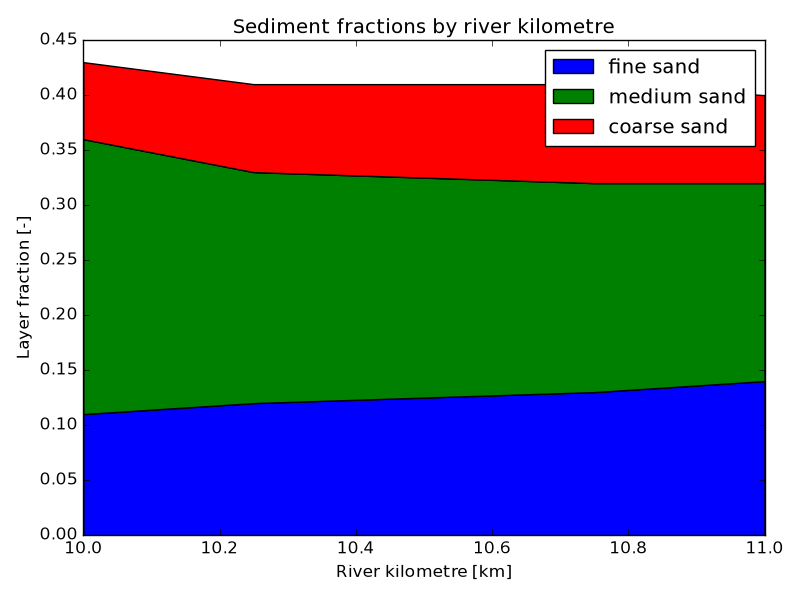
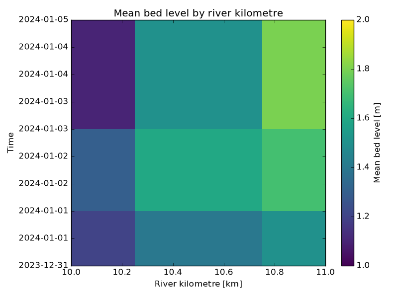

# Gallery

These figures are generated from small, deterministic arrays in the synthetic
plot-view tests. They contain no project simulation data and illustrate the
shared line and space-time views; actual figure content depends on the
configured variables, times, labels, and style.

## Stacked sediment fractions

The stacked-area view shows multiple sediment components while retaining
their combined value at each river-kilometre centre.

## Space-time profile

The space-time view places river kilometre on the horizontal axis and model
time on the vertical axis. The colour scale represents the plotted quantity.

For configuration options and currently supported analyses, see the
[user guide](./user-guide.md) and [configuration reference](./configuration.md).
